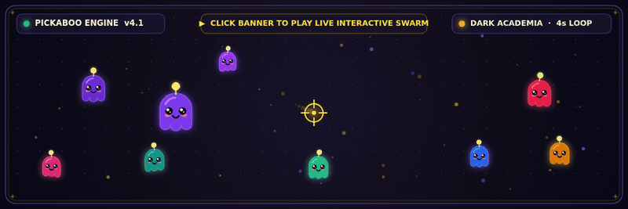

<div align="center">

<!-- PickaBoo Interactive Banner — click to launch live game -->
<a href="https://TeacherEvan.github.io/TeacherEvan/" target="_blank" title="Click to play PickaBoo v4.1 with spatial sound, chain reactions & physics sandbox!">
  
</a>

<br/><br/>

# 🇿🇦🇿🇦🇿🇦🀄️👾Ewaldt Botha👾🀄️🇿🇦🇿🇦🇿🇦
### Full-Stack creationist · Creative Technologist · Educator - Penguin

<p>
  <em>"I build things that scale, things that teach, and things that <strong>explode.</strong>"</em>
</p>

<!-- Status Badges -->
<p>
  
  
  
  
</p>

<p>
  <a href="https://TeacherEvan.github.io/TeacherEvan/">
    
  </a>
</p>

</div>

---

### 👾 About Me

```typescript
const PickaBoo: Creator = {
  name:     "Ewaldt Botha",
  handle:   "TeacherEvan",
  role:     "Full-Stack Builder & Creative Technologist",
  origin:   "🇿🇦 South Africa",
  pronouns: "he/him",

  languages: ["TypeScript", "JavaScript", "Python", "Go", "C#", "Rust"],

  frontend:  ["React", "Next.js", "TailwindCSS", "Three.js", "HTML5 Canvas", "WebGL"],
  backend:   ["Node.js", "FastAPI", "Django", "GraphQL", "gRPC"],
  databases: ["PostgreSQL", "MySQL", "MongoDB", "Redis"],
  cloud:     ["Docker", "Kubernetes", "AWS", "GCP", "GitHub Actions"],

  focus:     "Real-time interactive simulations, creative computing & distributed systems",
  passions:  ["Systems Architecture", "Pedagogy & Mentoring", "Creative Coding & Game Feel"],

  easterEgg: "Move your cursor near sprites in the live game to trigger 4s countdowns & chain reactions 💥"
};
```

---

### 🛠️ Tech Stack & Tooling

<div align="center">

**Languages**
<p>
  
</p>

**Frontend & Creative Computing**
<p>
  
</p>

**Backend & Architecture**
<p>
  
</p>

**Databases & Cloud Infrastructure**
<p>
  
</p>

</div>

---

### 🚀 Featured Work

| Project | Description | Stack | Links |
| :--- | :--- | :--- | :--- |
| 👾 **PickaBoo Engine v4.1** | Interactive sprite swarm with spatial Web Audio, camera trauma shake, cascading chain-reaction explosions, and a fixed-timestep physics sandbox | `Canvas` `Web Audio` `Vector Math` | [▶ Live Game](https://TeacherEvan.github.io/TeacherEvan/) · [Source](docs/index.html) |
| 🧪 **Engine Test Harness** | Headless-Chromium regression suite: frame-rate-independent physics, particle budget, pointer lifecycle, NaN guards and repo integrity | `node:test` `Playwright` | [Tests](tests/) |
| 🎞️ **Banner Asset Pipeline** | Deterministic 150-frame Canvas capture compiled to a palette-optimised looping GIF, plus the animated vector banner | `Node` `Playwright` `FFmpeg` | [Pipeline](scripts/capture_banner.js) · [Vector Banner](assets/pickaboo-banner.svg) |

---

### 📐 Engineering Notes

<p>
  
</p>

- **Deterministic simulation** — fixed 60 Hz timestep with an accumulator, so a 120 Hz monitor plays the exact same game as a 30 Hz one.
- **Bounded cost** — global particle ceiling, clamped velocities and exponential damping keep the frame budget flat under chain reactions.
- **Accessible by default** — keyboard-reachable controls, `aria-pressed` toggles, live reduced-motion support and pinch-zoom left enabled.
- **One source of truth** — a single engine file, a single banner generator, and a CI pipeline that fails the build if any of it drifts.

[Full architecture notes →](docs/ARCHITECTURE.md)

---

### 📬 Connect & Collaborate

<div align="center">

<a href="https://github.com/TeacherEvan">
  
</a>
<a href="mailto:ewiebotha@gmail.com">
  
</a>
<a href="https://TeacherEvan.github.io/TeacherEvan/">
  
</a>

<br/><br/>
<sub>⚡ <strong>PickaBoo Engine v4.1</strong> — Dark Academia Edition · Engineered by <a href="https://github.com/TeacherEvan">TeacherEvan</a></sub>

</div>
